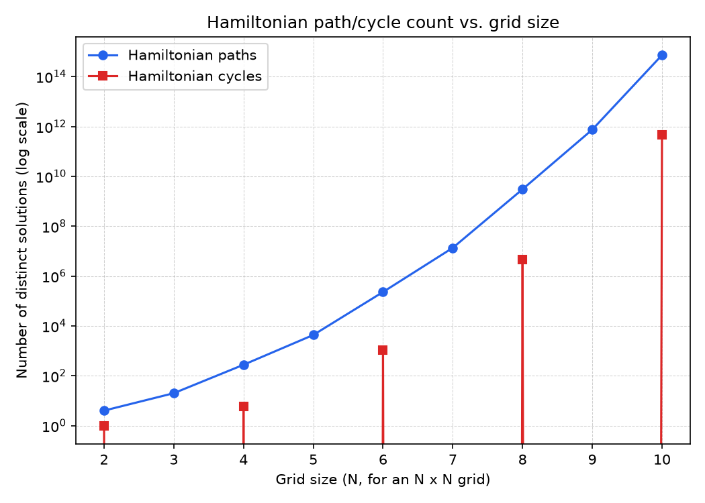
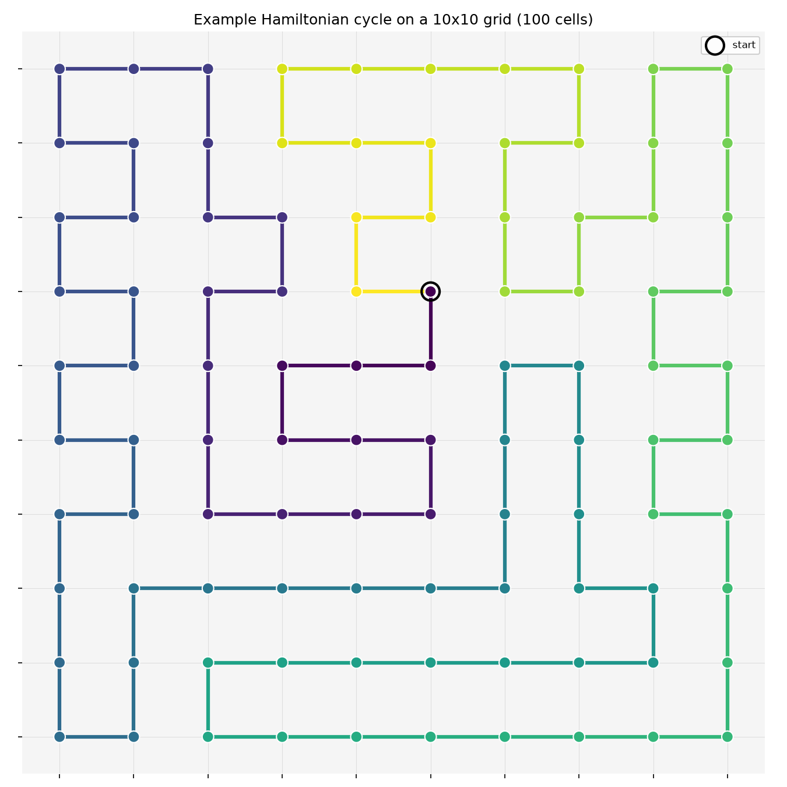
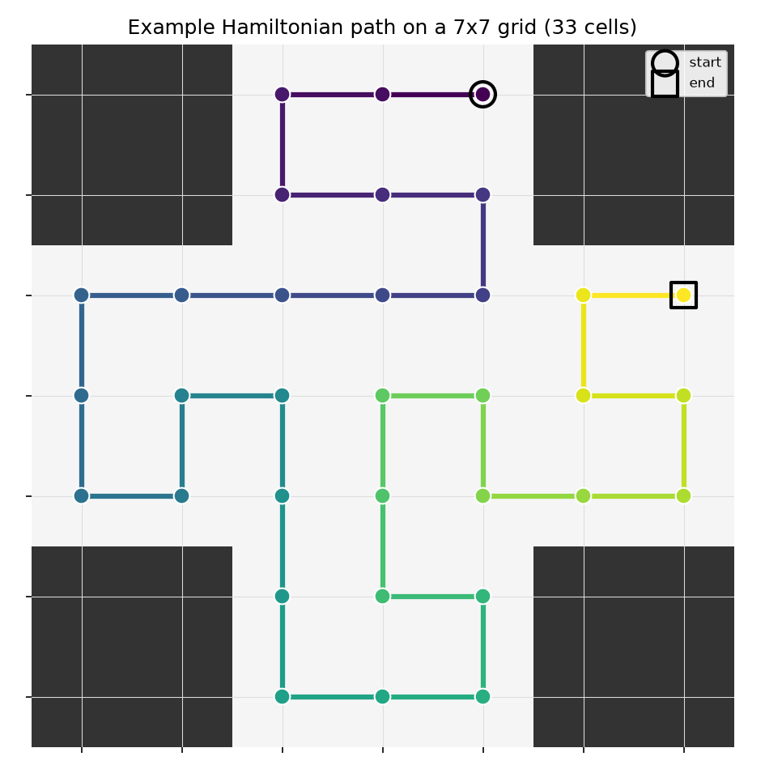

# HamiltonianPIPES

Hamiltonian path & cycle counter and visualizer for 2D grids.

A curiosity-driven tool: how many distinct ways are there to walk through
every cell of an N×N grid, visiting each exactly once? How does that count
grow as the grid gets bigger? What does one of those routes actually look
like? This explores exactly that, for grids from 2×2 up to 10×10, including
grids with blocked cells (so paths have to route around holes / arbitrary
shapes).

This is a standalone project, unrelated to PIPEGRID.

## What it computes

- **Hamiltonian path**: a route that visits every open cell of the grid
  exactly once.
- **Hamiltonian cycle**: same, but the route also returns to its starting
  cell (so it forms a loop).

Counts are of *distinct routes* — a path/cycle and its reverse traversal
are the same route, so they're counted once, not twice.

## Why this needed more than brute force

The number of solutions explodes fast. A 10×10 grid has **730,044,829,512,632**
distinct Hamiltonian paths and **467,260,456,608** distinct Hamiltonian
cycles — there is no enumerating those one at a time. Instead,
[`hamiltonian/profile_dp.py`](hamiltonian/profile_dp.py) implements a
"broken profile" (a.k.a. connectivity / plug) dynamic program: it sweeps
the grid cell by cell and tracks, along the boundary between the processed
and unprocessed region, which cells have a dangling path edge and which
other dangling edge each one is destined to connect to. This lets it count
every solution without ever constructing one, in time polynomial in the
grid area (a few seconds for the full 10×10, see `data/counts.csv`).

This is cross-validated against exhaustive brute-force enumeration
(`hamiltonian/brute_force.py`) on dozens of small grid shapes — rectangular,
with holes, degenerate — in `tests/test_cross_validate.py`, plus a larger
randomized fuzz run during development. As an independent sanity check, the
computed sequences for plain N×N grids match the published OEIS sequences
[A096969](https://oeis.org/A096969) (Hamiltonian paths) and
[A003763](https://oeis.org/A003763) (Hamiltonian cycles on 2n×2n grids).

For visualizing *one example* solution (not counting), a much simpler
DFS with Warnsdorff's-rule ordering and connectivity pruning
(`hamiltonian/brute_force.py`) finds a single path/cycle quickly, even on
grids too large to enumerate exhaustively.

## Install

```bash
python3 -m venv .venv && source .venv/bin/activate
pip install -r requirements.txt
```

## Use it

```bash
# Exact counts for a grid, with some cells blocked (row,col pairs)
python cli.py count --rows 6 --cols 6 --blocked 2,2 3,3

# Or load an arbitrary shape from an ASCII file ('.'=open, '#'=blocked)
python cli.py count --shape shapes/plus.txt

# Draw one example solution to a PNG
python cli.py visualize --rows 10 --cols 10 --kind path  --out figures/my_path.png
python cli.py visualize --rows 10 --cols 10 --kind cycle --out figures/my_cycle.png
python cli.py visualize --shape shapes/plus.txt --kind path --out figures/my_plus.png

# Regenerate the full 2x2..10x10 scaling dataset + plot
python cli.py dataset --min-n 2 --max-n 10 --out-dir data --figure figures/scaling_plot.png
```

Run the test suite (includes the brute-force cross-validation):

```bash
python -m pytest tests/ -q
```

## Results

Exact counts for every N×N grid from 2×2 to 10×10 (`data/counts.csv` /
`data/counts.json`):

| N   | Hamiltonian paths | Hamiltonian cycles |
|-----|-------------------:|--------------------:|
| 2   | 4 | 1 |
| 3   | 20 | 0 |
| 4   | 276 | 6 |
| 5   | 4,324 | 0 |
| 6   | 229,348 | 1,072 |
| 7   | 13,535,280 | 0 |
| 8   | 3,023,313,284 | 4,638,576 |
| 9   | 745,416,341,496 | 0 |
| 10  | 730,044,829,512,632 | 467,260,456,608 |

Odd-sized grids always have **0** Hamiltonian cycles: a grid graph is
bipartite (checkerboard-colorable), and a cycle must alternate colors, so
it needs equal numbers of each — impossible when the total cell count is
odd.



An example Hamiltonian cycle on the full 10×10 grid:



An example Hamiltonian path on a plus-shaped grid with blocked corners
(`shapes/plus.txt`):



## Interactive web version

[`web/hamilton-loom.html`](web/hamilton-loom.html) is a self-contained, no-install
GUI: open it in any browser to click cells to cut holes into a grid, see the
exact path/cycle counts update live, and watch an example route trace itself
onto the grid. It's a JavaScript port of the same broken-profile DP as the
Python package (validated against the Python implementation's outputs,
including the full 10x10 case), running in a Web Worker so the page stays
responsive during a multi-second count. No build step or server needed —
just open the file.

Solutions are explored through a single **"Browse solutions"** panel with an
order-by control -- "Any order" / "Fewest turns" / "Most turns" -- that
determines what "Browse paths"/"Browse cycles" shows, so there's one set of
buttons rather than separate browsing and ranking tools:

- **Any order** shows "Solution *k* of *total*" with Prev/Next, a jump-to-#
  field, and a Random button. This extends the DP into an *unranking*
  algorithm — given index *k*, it reconstructs the exact *k*-th solution
  directly (via a one-time forward+backward pass building per-step
  completion counts), rather than generating and discarding the ones
  before it, so Prev/Next, jump, and Random all stay exact and instant even
  with hundreds of trillions of solutions. Random draws a uniformly random
  index and reconstructs that one solution directly — there's no separate
  heuristic search for "just find me one" anymore; exact browsing already
  covers that case, and does it exactly instead of approximately.
- **Fewest/most turns** shows the top 10 solutions ranked by turn count — a
  cell counts as a turn when exactly two of its edges are present and
  they aren't a straight up-down/left-right pair. This is a *k*-best
  extension of the same DP: instead of tracking one completion count per
  boundary state, the backward pass keeps the *K* smallest (or largest)
  distinct turn-count totals per state, each with its own count, and
  truncating to the top *K* at every step is exact — not an approximation
  — by the same exchange argument that underlies k-shortest-path
  algorithms. The ranking metric is factored out into a single local
  function (`isTurn`), so it's a small change to add other ranking
  categories later.

Exhaustively verified against brute-force enumeration — every index, not a
sample, across dozens of grid shapes for browsing, and across grids with
holes, blocked cells, and endpoint constraints for ranking — before
shipping. (A blocked-cell edge case in the ranking DP's first draft, where
a transition wasn't chaining into the child state's rank list, was caught
in code review and fixed before it ever ran.)

You can also **pick a start and/or end cell** ("Pick start / end" mode):
the exact count and browsing both then respect that constraint (paths from
A to B, or just starting at A). This is a real algorithm change, not just a
filter -- a designated cell is forced to be a path endpoint and every other
cell is forbidden from being one, which required extending the DP's
transition rules and the unranking walk. There used to also be a fast
Warnsdorff-search path for picking one random solution, but its naive
endpoint-reservation approach turned out to be unreliable with two fixed
endpoints (verified against the exact DP: it reported "no path" for cases
with hundreds of valid solutions) — it's since been removed entirely in
favor of always routing through the exact indexed system above, which has
no such failure mode for any number of fixed endpoints. For a cycle, only
"start" applies, and it just rotates which cell the trace is drawn from,
since a cycle has no true endpoints.

## Project layout

```
hamiltonian/
  grid.py         Grid representation (rows, cols, blocked cells, ASCII I/O)
  profile_dp.py   Exact polynomial-time counter (broken-profile / plug DP)
  brute_force.py  Exhaustive counter (test ground truth) + fast single-
                   solution finder (for visualization)
  counting.py     Unified count_paths / count_cycles / example_path /
                   example_cycle interface
  dataset.py      Generates the N x N scaling dataset
  visualize.py    matplotlib rendering (example solution, scaling plot)
cli.py            Command-line entry point
tests/            pytest suite, including brute-force cross-validation
shapes/           example ASCII grid shapes
data/             generated counts.csv / counts.json
figures/          generated PNGs
web/              standalone interactive HTML GUI (JS port of the algorithm)
```

## Non-goals (for now)

- 3D grids (possible future extension)
- Any integration with PIPEGRID — this is fully standalone
